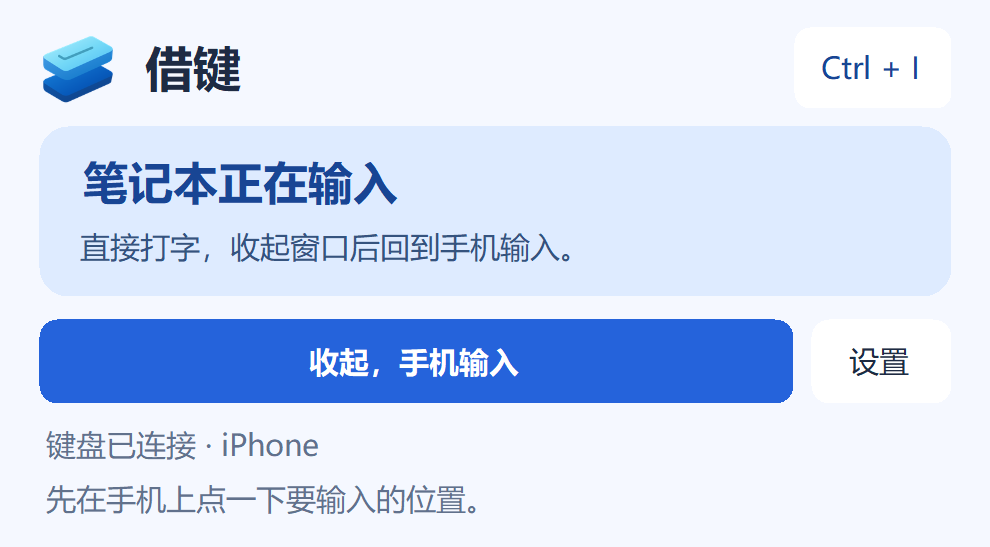

# 借键 KeyIn · 仅适配 iPhone

先用蓝牙把 iPhone 连到 Windows 电脑。点一下手机上的输入框，按 **Ctrl + I** 就能用电脑键盘打字，再按一次切回手机。iPhone 不用装 App。

## 下载

[Releases](https://github.com/renwuai/KeyIn/releases/)

## 第一次用

1. 打开电脑蓝牙，运行借键。窗口里会显示这台电脑的名称。
2. 在 iPhone 的「设置 → 蓝牙」里点这个名称，按提示配对。
3. 回到电脑，在借键里点「选择 iPhone」，选中自己的手机。以后这台手机重新连上，借键会记住它。

电脑的蓝牙适配器和驱动需要支持低功耗蓝牙外设模式（BLE Peripheral），iPhone 才能把电脑当作键盘。

## 平时怎么用

借键窗口变蓝、显示「笔记本正在输入」时，电脑上的按键会发到 iPhone 当前的输入框。打中文也用手机的输入法：电脑敲拼音，手机上选词。电脑剪贴板里的文字不会传过去。

收起借键或切到其他 Windows 窗口，电脑键盘就回到本机。托盘图标上的琥珀色暂停符号表示手机还连着，下次按快捷键就能继续打。灰色横线表示键盘还没连上，可以在 iPhone 蓝牙设置里再点一次电脑名称。

想换快捷键，在借键的设置里改。要换手机，点「清除绑定并重新检测」，再从列表里选。
